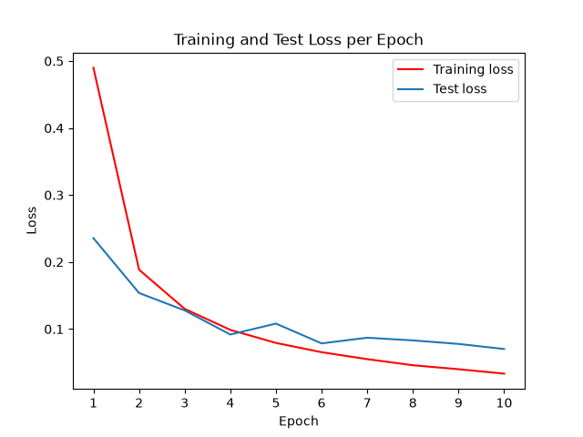
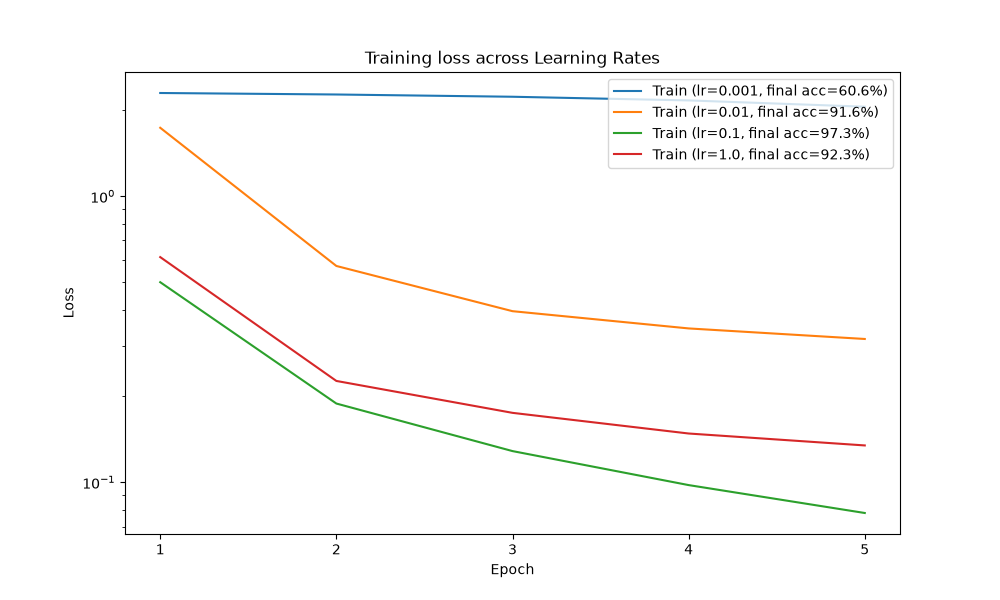
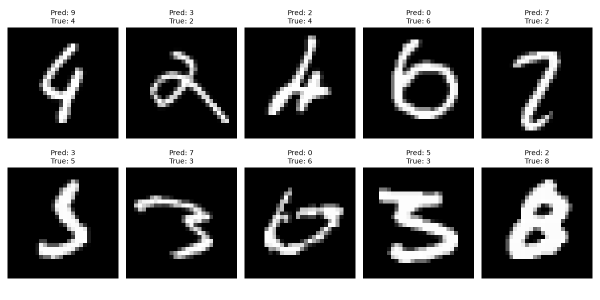

# MNIST Classifier

A fully connected neural network in PyTorch that classifies handwritten digits from the MNIST dataset with **97.89% test accuracy**. The training and evaluation loops are written by hand in plain PyTorch.

## Results

Trained for 10 epochs with SGD (learning rate 0.1, batch size 64, seed 42):

| Metric | Value |
| --- | --- |
| Test accuracy | 97.89% |
| Test loss | 0.0702 |
| Training loss | 0.0335 |



Training loss falls every epoch. Test loss levels off around epoch 6, so more epochs would give little extra accuracy.

### Learning rate comparison

Each learning rate was trained from scratch for 5 epochs:

| Learning rate | Test accuracy after 5 epochs |
| --- | --- |
| 0.001 | 60.64% |
| 0.01 | 91.58% |
| 0.1 | 97.28% |
| 1.0 | 92.29% |



A learning rate of 0.1 works best. 0.001 is too small to learn much in 5 epochs, and 1.0 is too large to settle on a good solution.

### Misclassified images

The trained model gets 211 of the 10,000 test images wrong. Here are ten of them, with the predicted and true labels:



Most of the mistakes are between digits with similar shapes: a 6 with a wide loop is predicted as 0, 3 and 5 are confused in both directions, and a 4 with a closed top is predicted as 9.

## Model architecture

`MNISTClassifier` is a multilayer perceptron with two hidden layers:

| Layer | Output size |
| --- | --- |
| Flatten (28 x 28 image) | 784 |
| Linear + ReLU | 128 |
| Linear + ReLU | 64 |
| Linear (one score per digit) | 10 |

- Loss: cross-entropy
- Optimizer: SGD
- Parameters: 109,386

## How to run

```bash
git clone https://github.com/ericmadsenIT/mnist-classifier.git
cd mnist-classifier
pip install -r requirements.txt
python src/train.py
```

A GPU is optional: the script uses one if PyTorch finds it and falls back to the CPU otherwise, where training takes a few minutes.

`train.py` downloads MNIST into `data/`, trains for 10 epochs, prints the test accuracy, saves the loss chart to `images/train_eval_loss.png`, and saves the model weights to `mnist_classifier.pth`.

To recreate the other two charts:

```bash
python src/experiments.py
```

`experiments.py` loads the saved weights if they exist (otherwise it trains a model first), saves the misclassified images chart, then runs the learning rate comparison.

## Project structure

```
mnist-classifier/
├── README.md
├── requirements.txt
├── .gitignore
├── src/
│   ├── data.py          # transform, datasets, DataLoaders
│   ├── model.py         # MNISTClassifier
│   ├── train.py         # train_one_epoch, evaluate_model, epoch_train_eval
│   └── experiments.py   # misclassified images, learning rate comparison
├── notebooks/
│   └── mnist_exploration.ipynb   # original exploration notebook
└── images/              # the 3 charts shown above
```

## What I learned

- **How a training loop works.** Writing `train_one_epoch` by hand showed me what each step does: the forward pass, the loss, `zero_grad`, `backward`, and the optimizer step.
- **Training and evaluation need different modes.** `model.eval()` switches layers like Dropout to evaluation behavior, and `torch.no_grad()` stops PyTorch from recording the graph, which saves memory and time. Neither changes the accuracy of this model; they make evaluation correct and efficient.
- **The learning rate matters more than I expected.** With the same model and data, accuracy after 5 epochs ranged from 60.64% to 97.28% depending only on the learning rate.
- **Reading a loss chart.** Training loss kept falling while test loss levelled off around epoch 6, which is the point where more training stops helping on new data.
- **Looking at the mistakes is useful.** The misclassified images showed that most errors are between digits with similar shapes, which accuracy alone does not tell you.
- **Notebook code and repo code are different.** Functions that relied on global variables broke once the code was split into files, so everything a function needs is now passed in as a parameter.
- **Reproducibility.** Setting a random seed makes every run give the same numbers, so the results in this README can be checked.

## Sanity checks I used

- **Untrained loss:** before training, the loss was 2.29, close to ln(10) ≈ 2.30. This is the expected loss when the model guesses 1 of 10 classes at random, so the loss function and labels were connected correctly.
- **Parameter count:** I calculated 109,386 parameters by hand (weights plus one bias per output) and checked the number in code.
- **Misclassified count:** 211 wrong images matches 100% − 97.89% of 10,000 test images.
- **Epoch 1 test loss is lower than training loss:** the training loss is an average over the whole epoch, including the first batches when the model was untrained. The test loss is measured after the epoch ends.

## Bugs I found and fixed

- **Gradients accumulate.** Calling `.backward()` three times gave gradients of 12, 24, then 36. This is why the loop calls `zero_grad()` before each `.backward()`.
- **`reshape` does not change the tensor.** It returns a new tensor, so the result must be stored.
- **dtype mismatch.** Matrix multiplication of an `int64` tensor and a `float32` tensor fails; PyTorch does not convert them for you.
- **Wrong count for accuracy.** Dividing by 64 × number of batches is wrong, because the last test batch has only 16 images. Accuracy uses `len(dataloader.dataset)`.
- **`list += numpy_array`.** NumPy handles the `+` and tries to add the values instead of extending the list. I used `.extend()` instead.

## Next steps

- Hold out a validation set for choosing the learning rate, and use the test set only for the final result.
- Replace the fully connected layers with a CNN (target: 99%).
- Try SGD with momentum or Adam, and compare the loss curves.
